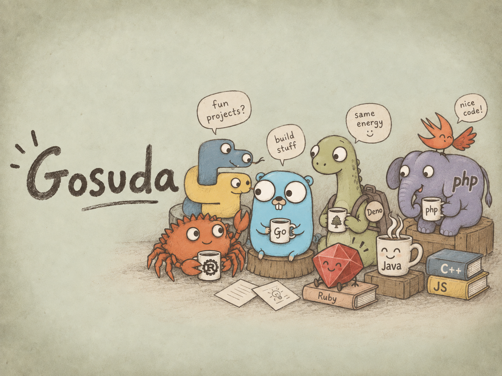

# Gosuda (고수다)

**An open community for people who love building things — sharing ideas, creating together, and having fun.**

## Projects

**Featured:** [bitcoin-rs](https://github.com/gosuda/bitcoin-rs) · [portal-tunnel](https://github.com/gosuda/portal-tunnel) · [LoGOs](https://github.com/gosuda/LoGOs) · [spira](https://github.com/gosuda/spira) · [gglint](https://github.com/gosuda/gglint) · [IVNP](https://github.com/gosuda/IVNP) · [sloplint](https://github.com/gosuda/sloplint) · [dstack-skills](https://github.com/gosuda/dstack-skills)

The index below covers active public repositories. For everything else, see the [full repository list](https://github.com/orgs/gosuda/repositories).

### Coding agents and agentic engineering

| Project | What it is |
|---|---|
| [dalgona](https://github.com/gosuda/dalgona) | Minimal, pluggable coding agent (dal) plus opinionated batteries (dalgona), extensible with Starlark plugins |
| [dstack](https://github.com/gosuda/dstack) | Opinionated engineering methodology between vibes and specs |
| [dstack-skills](https://github.com/gosuda/dstack-skills) | Agent skills for agentic engineering with DStack |
| [ruk](https://github.com/gosuda/ruk) | Next-generation Git for the agent era, in Rust |
| [rukie](https://github.com/gosuda/rukie) | Self-hosted Git hosting, review, tasks, and CI for developers and coding agents, powered by ruk |
| [cohotfs](https://github.com/gosuda/cohotfs) | Reproducible container workspaces that give a coding agent a room of its own |
| [dalcom-reflector](https://github.com/gosuda/dalcom-reflector) | Meta-reflection layer for dstack; plugin for Codex, Claude Code, and oh-my-pi |
| [dstack-reflector](https://github.com/gosuda/dstack-reflector) | Codex CLI meta-reflection layer for dalstack |
| [dalzzack](https://github.com/gosuda/dalzzack) | Screenshot-first, token-efficient browser automation CLI for agents (macOS, Windows) |
| [gyemoim](https://github.com/gosuda/gyemoim) | Local LLM gateway with centralized provider auth and request observability |
| [Handeln](https://github.com/gosuda/Handeln) | AI agent toolbox |
| [JustGoodPractices](https://github.com/gosuda/JustGoodPractices) | Provider-neutral agent skills pack and Go analyzer distilled from 147 engineering lessons |
| [micke](https://github.com/gosuda/micke) | Disposable Linux desktop (Xvfb + XFCE + chromium over noVNC) for AI agents, driven over MCP |
| [pi-oxidized](https://github.com/gosuda/pi-oxidized) | Rust coding agent with TypeScript plugin compatibility |

### Portal and networking

| Project | What it is |
|---|---|
| [portal-tunnel](https://github.com/gosuda/portal-tunnel) | Publish localhost services to the agentic web through self-hostable, trustless relays |
| [portal-android-sdk](https://github.com/gosuda/portal-android-sdk) | Android (Kotlin) SDK for portal-tunnel |
| [portal-expose](https://github.com/gosuda/portal-expose) | Kubernetes controller that exposes pods to the Portal network |
| [portal-flutter-sdk](https://github.com/gosuda/portal-flutter-sdk) | Flutter SDK for portal-tunnel |
| [portal-ios-sdk](https://github.com/gosuda/portal-ios-sdk) | iOS (Swift) SDK for portal-tunnel |
| [portal-multiplatform-sdk](https://github.com/gosuda/portal-multiplatform-sdk) | Kotlin Multiplatform SDK exposing app-local servers through Portal relays |
| [portal-toys](https://github.com/gosuda/portal-toys) | Toy projects built on portal |
| [portal-x402-sdk](https://github.com/gosuda/portal-x402-sdk) | TypeScript SDK wrapping x402 payment, ERC-8004 identity, and ENSIP-25 verification for portal relays |
| [portalite](https://github.com/gosuda/portalite) | Lightweight portal client |
| [potly](https://github.com/gosuda/potly) | Short links, QR codes, and file sharing for multi-agent, multi-machine workflows |
| [IVNP](https://github.com/gosuda/IVNP) | InVisible Network Protocol: Go implementation of the I2P protocol and router |
| [AutoIRC2P](https://github.com/gosuda/AutoIRC2P) | IRC2P chat with optional auto-translation and a built-in I2P router |
| [BiBeam](https://github.com/gosuda/BiBeam) | Collaborative, distributed, end-to-end P2P VPN in Rust |
| [jailscale](https://github.com/gosuda/jailscale) | Expose a local port over HTTPS: one wildcard hub, nodes that terminate TLS themselves |
| [maek](https://github.com/gosuda/maek) | Expose private web services to anyone without port forwarding, in one command |
| [ssh-chat](https://github.com/gosuda/ssh-chat) | Chat over SSH |
| [zeroproxy](https://github.com/gosuda/zeroproxy) | Web-based, zero-knowledge, zero-installation proxy in Rust |

### Bitcoin and payments

| Project | What it is |
|---|---|
| [bitcoin-rs](https://github.com/gosuda/bitcoin-rs) | Independent bitcoin full node in Rust |
| [bitcoin-wallet](https://github.com/gosuda/bitcoin-wallet) | Bitcoin wallet for desktop, iOS, Android, and the browser on one Rust (BDK) core |
| [bitcoin-rs-fuzz-corpus](https://github.com/gosuda/bitcoin-rs-fuzz-corpus) | Fuzzing corpora for bitcoin-rs |
| [x402-facilitator](https://github.com/gosuda/x402-facilitator) | Go implementation of an x402 payment facilitator |

### Languages, compilers, and runtimes

| Project | What it is |
|---|---|
| [LoGOs](https://github.com/gosuda/LoGOs) | The LoGOs programming language: Go, elegantly done right |
| [spira](https://github.com/gosuda/spira) | The Spring web framework done right, in TypeScript |
| [bamTiScript](https://github.com/gosuda/bamTiScript) | Clean-room TypeScript 7.0.2 compiler and JavaScript runtime in Rust, with JIT/AOT and Lean 4 models |
| [Charamel](https://github.com/gosuda/Charamel) | The Charm terminal ecosystem re-derived in pure OCaml: sixteen libraries, ten tools |
| [elegant-mermaid](https://github.com/gosuda/elegant-mermaid) | Render, check, and lint Mermaid diagrams without a browser; CLI plus Go, Rust, and Node libraries |
| [fasterapi](https://github.com/gosuda/fasterapi) | Drop-in faster replacement for FastAPI, in Rust |
| [oxvim](https://github.com/gosuda/oxvim) | Neovim rewritten in Rust, preserving the Lua plugin ecosystem |

### Developer tools and infrastructure

| Project | What it is |
|---|---|
| [gglint](https://github.com/gosuda/gglint) | The Go linter, finally done right |
| [sloplint](https://github.com/gosuda/sloplint) | Tree-sitter linter for complexity, searchable code, and agent editability across 23 languages |
| [flats](https://github.com/gosuda/flats) | Sites and artifacts hosting alternative |
| [Zapbrew](https://github.com/gosuda/Zapbrew) | Homebrew-compatible package manager in Rust; installs bottles without Ruby |
| [gittul](https://github.com/gosuda/gittul) | Distributed Git serving system |
| [katsi](https://github.com/gosuda/katsi) | Pico GitOps manager |
| [go-release-notes](https://github.com/gosuda/go-release-notes) | Go release notes |
| [go-websocket-libraries](https://github.com/gosuda/go-websocket-libraries) | Go WebSocket library comparison |
| [gosuda-template-rust](https://github.com/gosuda/gosuda-template-rust) | Official AI-native Rust template for gosuda repositories |
| [robust-rs-template](https://github.com/gosuda/robust-rs-template) | Robust Rust project template |
| [t1-faker.vim](https://github.com/gosuda/t1-faker.vim) | Vim colorscheme inspired by T1 team colors |

### Libraries

| Project | What it is |
|---|---|
| [randflake](https://github.com/gosuda/randflake) | Distributed, uniform, unpredictable unique random ID generator for Go |
| [HQQ](https://github.com/gosuda/HQQ) | Efficient interprocess communication for Go |
| [hqq-sqlite3](https://github.com/gosuda/hqq-sqlite3) | Zero-cgo SQLite `database/sql` driver over HQQ shared-memory IPC |
| [hqq-zstd](https://github.com/gosuda/hqq-zstd) | Zero-cgo Zstandard for Go over HQQ shared-memory IPC |
| [pg18_query_go](https://github.com/gosuda/pg18_query_go) | CGo-free, pure Go PostgreSQL 18 SQL parser |
| [gopherdis](https://github.com/gosuda/gopherdis) | Redis-compatible in-memory store in pure Go with multi-VM Lua |
| [fluxmq](https://github.com/gosuda/fluxmq) | Lightweight, fast message queue in Rust |
| [keyless_tls](https://github.com/gosuda/keyless_tls) | Keyless TLS in Go: remote signer delegates CertificateVerify over secure HTTP |
| [dbsc-rs](https://github.com/gosuda/dbsc-rs) | Rust implementation of Device Bound Session Credentials (W3C DBSC) |
| [zodrs](https://github.com/gosuda/zodrs) | Fast, sane drop-in replacement for Zod, in Rust |
| [beaver](https://github.com/gosuda/beaver) | Fast allocators for Go |
| [chromenet](https://github.com/gosuda/chromenet) | Portable Chromium network engine for Go |
| [gobus](https://github.com/gosuda/gobus) | FreeDesktop D-Bus wrapper for Go |
| [gstime](https://github.com/gosuda/gstime) | GSTime and GSTimeAssure |
| [luaudis](https://github.com/gosuda/luaudis) | Write Redis scripts in Luau, a statically typed Lua dialect |
| [ornn](https://github.com/gosuda/ornn) | Generate database-access code from schema and SQL |
| [schottky](https://github.com/gosuda/schottky) | Flexible sort-key encoding library for Go |
| [unipath](https://github.com/gosuda/unipath) | Toolkit for categorizing and handling URL protocols |
| [VivaceJSON](https://github.com/gosuda/VivaceJSON) | Ultra-fast JSON serializer and parser |
| [BamtiGraph](https://github.com/gosuda/BamtiGraph) | Time-series charts from your own data, in the browser, TypeScript, or Go |

### Apps and services

| Project | What it is |
|---|---|
| [asko](https://github.com/gosuda/asko) | AI-powered summaries for KakaoTalk Open Chat, in OCaml |
| [securl](https://github.com/gosuda/securl) | Secure URL shortener that respects user privacy |
| [nozik](https://github.com/gosuda/nozik) | Nozik, the AI music player |
| [gozik](https://github.com/gosuda/gozik) | Music player written in Go with GTK3 |
| [gozik-spotify](https://github.com/gosuda/gozik-spotify) | Spotify plugin for gozik |
| [gozik-yt-music](https://github.com/gosuda/gozik-yt-music) | YouTube Music plugin for gozik |
| [aibrow](https://github.com/gosuda/aibrow) | AI photo retouch app |
| [deeplingua](https://github.com/gosuda/deeplingua) | LLM-based translation for structured documents |
| [discord-autodelete](https://github.com/gosuda/discord-autodelete) | Bot that deletes Discord posts past a chosen age, channel by channel |
| [moreconsensus](https://github.com/gosuda/moreconsensus) | Simulation: there is more consensus in egalitarian parliaments |
| [oh-my-health-data](https://github.com/gosuda/oh-my-health-data) | Where conscription health-exam data goes, and when it is deleted |
| [proof-of-resource](https://github.com/gosuda/proof-of-resource) | Proof of resource usage for bandwidth, storage, and compute |
| [resume-feedback-platform](https://github.com/gosuda/resume-feedback-platform) | Anonymous resume and portfolio review platform for job seekers |
| [teatime](https://github.com/gosuda/teatime) | Standalone T-HUB Connector for Windows, Linux, and macOS |

### Community and meta

| Project | What it is |
|---|---|
| [1](https://github.com/gosuda/1) | Contribution entry point for the gosuda monorepo: workspaces, landing requests, review PRs, onboarding |
| [website](https://github.com/gosuda/website) | Home of gosuda.org: go-import endpoints and the blog |
| [rules.gosuda.org](https://github.com/gosuda/rules.gosuda.org) | Community guidelines site |
| [badge-api.gosuda.org](https://github.com/gosuda/badge-api.gosuda.org) | Small badges for whatever deserves a little attention |
| [telemetry.gosuda.org](https://github.com/gosuda/telemetry.gosuda.org) | Blog telemetry service |
| [.github](https://github.com/gosuda/.github) | This profile |

### Forks we maintain

| Project | What it is |
|---|---|
| [Iris](https://github.com/gosuda/Iris) | Iris fork powering asko |
| [bubbletea](https://github.com/gosuda/bubbletea) | TUI framework fork |
| [codesearch](https://github.com/gosuda/codesearch) | Fast indexed regexp search over large file trees |
| [gotreesitter](https://github.com/gosuda/gotreesitter) | Pure Go tree-sitter runtime |
| [zoekt](https://github.com/gosuda/zoekt) | Fast trigram-based code search |

Also public but lighter on detail: [gosuda.org](https://github.com/gosuda/gosuda.org), [portal_vibe_con](https://github.com/gosuda/portal_vibe_con).

## Administrators

Our admins help keep the community welcoming, organized, and running smoothly.  
If you have any questions or concerns, feel free to reach out anytime.

- **Organizer:** [gosunuts](https://github.com/gosunuts)
- **Admin:** [lemon-mint](https://github.com/lemon-mint)
- **Admin:** [iwanhae](https://github.com/iwanhae)
- **Admin:** [rabbitson87](https://github.com/rabbitson87)
- **Admin:** [thumbgo](https://github.com/yoonhyunwoo)
- **Admin:** [metaphoric-dev](https://github.com/metaphoric-dev)

## Community

- **Chat Room:**  [open.kakao.com/o/gd5mx3E](https://open.kakao.com/o/gd5mx3E)
- **Community Guidelines:** [rules.gosuda.org](https://rules.gosuda.org/)
- **Official Blog:** [gosuda.org](https://gosuda.org/)
- **Reddit Community:** [r/gosuda](https://www.reddit.com/r/gosuda/)
- **Discord:** [discord](https://discord.gg/SxSXVkp9JB)

---

